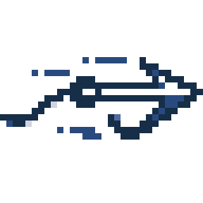

# Get Over Here!



A small Windows app living in the notification area. When you touch the secondary screen (an Android tablet used through **SuperDisplay**), the mouse cursor **and the keyboard focus** come right back to where they were.

- The **finger** triggers the return.
- The **mouse / touchpad** (even on the tablet) and the **pen** keep their normal behaviour.

## Usage

- Executable: `dist\GetOverHere.exe` (~200 KB, requires the .NET 10 Desktop runtime).
- Starts with Windows (`HKCU\Software\Microsoft\Windows\CurrentVersion\Run\GetOverHere`).
- **Double-click** the icon: pause / resume.
- **Right-click** the icon for the options:
  - *Also restore keyboard focus*: the window you were typing in stays active after a touch.
  - *Zero-move mode (experimental)*: blocks the cursor moves caused by touch. Modern apps still receive the touch; some legacy apps may stop responding to it.
  - *Diagnostic log*: writes every event to `%APPDATA%\GetOverHere\diag.log`.

Settings: `%APPDATA%\GetOverHere\settings.json`.

| Setting | Default | Meaning |
|---|---|---|
| `RestoreDelayMs` | 60 | Delay after the finger is lifted before the cursor comes back |
| `HeldTimeoutMs` | 4000 | Restore after this much silence if the release is never seen |
| `RawQuietMs` | 250 | End of a touch seen only through raw touch-screen reports |
| `FocusGuardMs` | 1500 | How long a late focus grab by the touched window is still reverted |

### Upgrading from TouchBack

The app used to be called *TouchBack*. On first launch, *Get Over Here!* copies `%APPDATA%\TouchBack\settings.json` (if it has no settings of its own yet) and replaces the old `TouchBack` startup entry with its own. The old folder is left untouched and can be deleted.

## How it works

1. **Telling touch apart from the mouse.** A low-level mouse hook (`WH_MOUSE_LL`) reads `dwExtraInfo` on every event. Windows stamps events generated by a touch screen or a pen with the signature `0xFF5157xx` (bit `0x80` = finger). Anything else is the real mouse.
2. **Knowing when the finger lands.** Those mouse events only arrive when the finger is **lifted**, whereas the touched window takes the focus as soon as the finger **lands**. The app therefore also reads the touch screen directly (Raw Input, HID page Digitizer / Touch Screen) and keeps a timestamped history of foreground changes (`SetWinEventHook`) to find the window that was active just before.
3. **Bringing everything back.** When the touch ends (60 ms after the release, or as soon as the real mouse moves), the cursor is put back with an injected mouse move, which makes it visible again, aimed at the exact pixel. The focus is then given back to the original window. For 1.5 s afterwards, if the touched window grabs the focus late, it is taken back again.

Nothing expensive is done inside the mouse hook itself: Windows would stall (~300 ms) and drop events.

### Code map

| File | Role |
|---|---|
| `TouchGuard.cs` | Core state machine: touch sessions, cursor and focus restore |
| `MouseHook.cs`, `RawTouchInput.cs`, `ForegroundWatcher.cs` | Win32 signal sources |
| `ForegroundHistory.cs` | Timestamped foreground history |
| `OwnInput.cs`, `FocusRestorer.cs` | Cursor move and foreground switch, Win32 side |
| `Platform.cs` | Abstractions used by `TouchGuard` (clock, timer, dispatcher, system) |
| `MonitorInfo.cs` | Finds the SuperDisplay monitor |
| `Settings.cs`, `Startup.cs`, `LegacyMigration.cs`, `DiagnosticLog.cs` | Persistence, startup entry, upgrade, log |
| `TrayApp.cs`, `Program.cs`, `AppInfo.cs` | Notification-area UI, entry point, app identity |
| `AppIcons.cs`, `TaskbarTheme.cs` | Embedded icons, light / dark taskbar detection |

### Icon

The icon is a pixel-art harpoon. Its source lives in `Assets/`:

| File | Role |
|---|---|
| `icon-source.jpg` | Original artwork (JPEG, white background) |
| `icon-pixels.png` | Clean 32x13 pixel art extracted from it (transparent background, exact colours) |
| `GetOverHere.ico` / `GetOverHere-paused.ico` | Generated icons for a light taskbar, 16 to 256 px (the paused one is greyed out) |
| `GetOverHere-dark.ico` / `GetOverHere-dark-paused.ico` | Same for a dark taskbar: colours inverted, white harpoon |
| `icon-256.png` / `icon-256-dark.png` | Large previews |

`GetOverHere.ico` is the executable's icon; the four `.ico` files are embedded and used in the notification area. Empty cells enclosed by the outline are painted white, as in the original drawing.

The notification-area icon follows the taskbar theme (`SystemUsesLightTheme` in `HKCU\Software\Microsoft\Windows\CurrentVersion\Themes\Personalize`, see `TaskbarTheme.cs`), and switches live when Windows changes between light and dark mode. In the dark variant the navy outline and the white interior swap places, so the harpoon is white; the other colours (blue accents) get their lightness inverted and keep their hue.

To regenerate the icons after editing `icon-pixels.png`:

```bash
pwsh GetOverHere/Assets/make-icons.ps1
```

(`-Resample` re-extracts `icon-pixels.png` from the JPEG.)

## Building

```bash
dotnet publish GetOverHere -c Release -r win-x64 -p:SelfContained=false -p:PublishSingleFile=true -p:DebugType=none -o GetOverHere/dist
```

(Quit the app first, otherwise the executable is locked.)

## Tests

Project `GetOverHere.Tests` (xUnit), run from the `app-ecrans` folder:

```bash
dotnet test GetOverHere.slnx
```

- **Unit tests** (~150, under 1 s): `TouchGuard`'s logic is replayed to the millisecond with a simulated clock, timer, message queue and Windows (`Support\TouchRig.cs`). The rig reproduces what was observed in real logs: burst of events on finger release, touched window activated on contact, etc. Also covered: event classification, focus history, coordinate conversion, settings, startup entry (in a throwaway registry key), upgrade from TouchBack, and the log.
- **Integration tests** (`Category=Integration`, ~20, a few seconds): real Windows hook, real cursor, real windows, and the full pipeline driven by simulated touches carrying Windows' touch signature (no click is ever injected). They briefly move the cursor and change the active window. **Quit the app before running them**, otherwise it reacts to the simulated touches too (a test checks this and says so).

Unit tests only:

```bash
dotnet test GetOverHere.slnx --filter Category!=Integration
```

## Limitations

- A window running **as administrator** cannot be brought back to the foreground by a non-admin app (Windows isolation).
- Multi-finger gestures (pinch, two-finger scroll) sometimes generate no mouse event at all: in that case there is nothing to fix.
